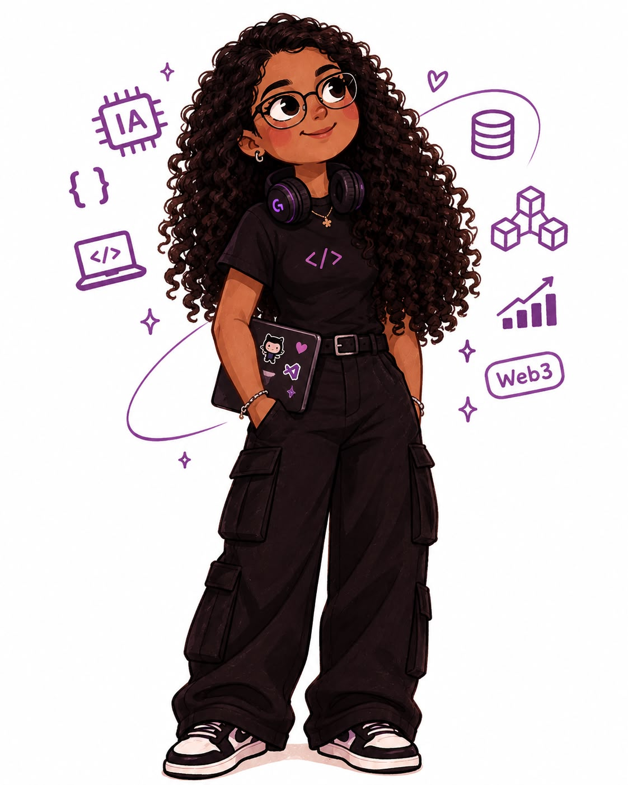

<h2>Sobre mim</h2>

  🎓 Graduada em Sistemas de Informação pela Universidade Cidade de São Paulo.
      
  🚀 Foco Atual: Análise de Dados.
      
  💡 Interesse de Estudo: Dados, IA e Cibersegurança.

    
    
    
    

<h2>Tech Stack</h2>

  

## Certifications and Course

**Alura**
* Análise de Dados e IA (concluído)

**Santander Jornada Tech AWS**
* Computação em Nuvem (concluído)
* Inteligência Artificial (concluído)

**Cisco Networking Academy**
* Introduction to Cybersecurity 

## 🏆 Hackathons 
* **Superteam Brasil — Privacy Week Winner** *(Outubro/2026)*
  * **Projeto:** [Cofre Privado](https://proxfrito.com.br/lab/cofre-privado)  
  * **Destaque:** Um dos 10 projetos premiados no sprint focado em privacidade na *mainnet* da Solana, integrando soluções como Cloak/Zcash durante o ciclo do Hackathon Colosseum.

## GitHub Stats

  
  

## Contribution Activity
<picture>
  <source
    media="(prefers-color-scheme: dark)"
    srcset="https://raw.githubusercontent.com/tauanebraz/tauanebraz/output/pacman-contribution-graph-dark.svg"
  />
  <source
    media="(prefers-color-scheme: light)"
    srcset="https://raw.githubusercontent.com/tauanebraz/tauanebraz/output/pacman-contribution-graph.svg"
  />
  
</picture>

## Connect with me

  
  

